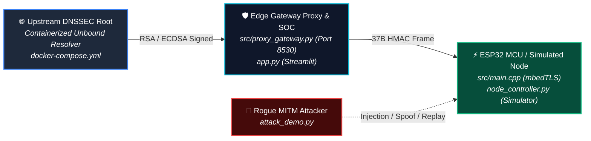

# 🛡️ AIORI Gateway-Assisted DNSSEC & ESP32 Hardware Last-Mile HMAC Assurance

> **Problem Statement:** A3-PS004 | **Team:** TC-093 | **Project Name:** AIORI Security Operations Center

A high-performance edge-security architecture designed to offload heavy DNSSEC (RSA-2048 / ECDSA) validation from resource-constrained IoT nodes to a Linux Edge Gateway, while maintaining last-mile cryptographic integrity over local Wi-Fi via 37-byte structured frames and hardware-backed HMAC-SHA256 verification.

---

## 🏗️ End-to-End System Architecture



## 📦 37-Byte Wire Frame Layout

To minimize SRAM overhead and memory copies on the ESP32, resolved DNS records are encapsulated into a fixed 37-byte binary payload:

```text
+------------------------+------------------------+-----------------------------------+
| IPv4 Address Payload   | Gateway Status Flag    | HMAC-SHA256 Signature             |
| (Bytes 0 - 3)          | (Byte 4)               | (Bytes 5 - 36)                    |
+------------------------+------------------------+-----------------------------------+
| e.g. 10.0.0.1          | 0x00 (Valid)           | 32-Byte Cryptographic Hash        |
|                        | 0x01 (BOGUS RRSIG)     | Computed over Bytes 0 - 4         |
+------------------------+------------------------+-----------------------------------+
```

## 🛡️ Threat Vector Verification Suite

Our test suite evaluates 5 distinct attack vectors across the network topology:

| Scenario | Attack Vector | Security Mechanism | System Outcome |
| :--- | :--- | :--- | :--- |
| **S1** | Legitimate Query (`secure.aiori.lab`) | Unbound DNSSEC + ESP32 `mbedTLS` HMAC | **Approved (0x00)** |
| **S2** | Upstream DNSSEC Poisoning | Gateway Catch & Null-Route (`0.0.0.0`) | **Gateway Drop (0x01)** |
| **S3** | Wi-Fi Local Packet Injection | MCU HMAC-SHA256 Signature Comparison | **MCU Discard (0xFE)** |
| **S4** | Rogue Gateway Impersonation | Shared eFuse Key Verification | **MCU Key Reject** |
| **S5** | Replay / Stale Payload Attack | Rolling Sequence Counter HMAC | **Replay Reject** |

---

## 🚀 Quick Start Guide

### Prerequisites
* Linux / WSL2 Environment
* Docker & Docker Compose
* Python 3.10+ (`streamlit`, `socket`, `hmac`)

### 1. Launch Docker Gateway Services
docker compose up -d

### 2. Start the Interactive SOC Dashboard
streamlit run app.py

### 3. Run Automated Terminal Test Suite
bash demo.sh

---

## 📁 Repository Structure

```text
├── app.py                  # Streamlit SOC Dashboard & Hardware Animator
├── proxy_gateway.py        # Edge Gateway Proxy & 37-Byte Encoder (Port 8530)
├── unbound_resolver.py     # Recursive Unbound DNSSEC Validation Wrapper
├── node_controller.py      # Attack Trajectory Engine & Fallback Simulation
├── attack_demo.py          # Command-Line Threat Vector Demonstrator
├── demo.sh                 # End-to-End Test Suite Executable
├── docker-compose.yml      # Containerized Unbound Resolver Setup
└── src/
    └── main.cpp            # ESP32 C++ mbedTLS Verification Logic
```
