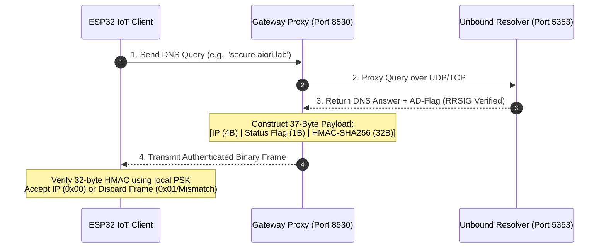

# PS-004: Authenticated Gateway-Assisted DNSSEC for IoT Clients

**Team ID:** TC093  
**Track:** AIORI Hackathon - IoT & Edge Security  

---

## 📌 Problem Overview

Resource-constrained IoT microcontrollers (e.g., ESP32) lack the computational memory and stack bandwidth required to perform full DNSSEC cryptographic validation, complex chain-of-trust parsing, and public key RSA/ECDSA verification. This limitation leaves edge nodes vulnerable to local Wi-Fi Man-in-the-Middle (MITM) attacks, DNS cache poisoning, and rogue gateway impersonation.

This project implements an **Authenticated Gateway-Assisted DNSSEC Architecture**. An edge gateway handles upstream Unbound DNSSEC validation, extracts the Authenticated Data (AD) flag, and extends cryptographic trust across the last mile to the IoT node via a lightweight **37-byte HMAC-SHA256 authenticated binary frame**.

---

## 📽️ Project Demonstrations & Videos

* **Round 1 Demo Video:** [Watch on YouTube](https://youtu.be/jABrWfCZKCs?si=P8RhQC_bHtCmWz1x)
* **Round 2 Final Proof-of-Concept Video:** [Watch on YouTube](https://youtu.be/HBuEAOm0DVE?si=KeEvFNIZhkMj4hde)

---

## 🏗️ Solution Architecture & Data Flow
## 🏗️ Solution Architecture & Data Flow



1. **DNSSEC Offloading:** The Unbound Docker container resolves target zones (`secure.aiori.lab`, `bogus.aiori.lab`, `insecure.aiori.lab`) and performs upstream RRSIG validation.
2. **Payload Packaging:** The Gateway Proxy constructs a 37-byte binary payload:
   - `0..3`   : IPv4 Address (4 bytes)
   - `4`      : DNSSEC Status Flag (`0x00` SECURE, `0x01` BOGUS, `0x02` INSECURE, `0x03` UNAUTHENTICATED) (1 byte)
   - `5..36`  : HMAC-SHA256 Signature over bytes `[0..4]` using Pre-Shared Key (PSK) (32 bytes)
3. **Last-Mile Verification:** The IoT client verifies the 32-byte HMAC signature against its internal PSK (simulating secure eFuse storage). If valid, the IP address is accepted; if forged, the packet is discarded.

---

## 📊 Threat Matrix & Security Scenarios

| Scenario | Targeted Domain | Gateway DNSSEC State | Client HMAC Verification | System Action / Decision |
| :--- | :--- | :--- | :--- | :--- |
| **1. Legitimate Query** | `secure.aiori.lab` | `0x00` (SECURE / AD VERIFIED) | Authentic Signature | **[✓ ACCESS GRANTED]** Connection established (`10.0.0.1`) |
| **2. Upstream DNS Spoofing** | `bogus.aiori.lab` | `0x01` (BOGUS / INVALID RRSIG) | Authentic Gateway Alert | **[✓ DROPPED]** Spoofing blocked at edge (`0.0.0.0`) |
| **3. Unsigned Domain** | `insecure.aiori.lab` | `0x02` (INSECURE / UNSIGNED) | Authentic Gateway Alert | **[! WARNING]** Fallback policy applied |
| **4. Over-the-Air MITM** | `secure.aiori.lab` | `0x00` (Tampered in transit) | Signature Mismatch | **[✓ DROPPED]** Intercepted frame discarded by client |
| **5. Rogue Gateway Attack** | `secure.aiori.lab` | Untrusted Proxy Key | Invalid PSK / Mismatch | **[✓ DROPPED]** Untrusted gateway rejected at edge |

---

## 📂 Repository Structure

```text
A3-PS004-TC093/
├── A3-PS004-TC093.pdf        # Project Technical Proposal & Specifications
├── README.md                 # Project Overview & Setup Instructions
└── src/
    ├── app.py                # Streamlit Real-Time Security Dashboard
    ├── attack_demo.py        # Automated 5-Scenario Security Validation Suite
    ├── node_controller.py    # Interactive Role-Based Node Simulator (owner / hacker)
    ├── demo.sh               # Execution Orchestration Script
    ├── esp32_client/         # IoT Client Implementation & Cryptographic Parser
    └── gateway/
        ├── Dockerfile        # Custom Unbound Build File
        ├── docker-compose.yml# Container Port Mapping (5353) & Volume Config
        ├── gateway_proxy.py  # 37-Byte Frame Generator & HMAC Signer
        ├── requirements.txt  # Python Dependencies
        └── zones/
            └── zones.conf    # Authoritative DNSSEC Zone Definitions
